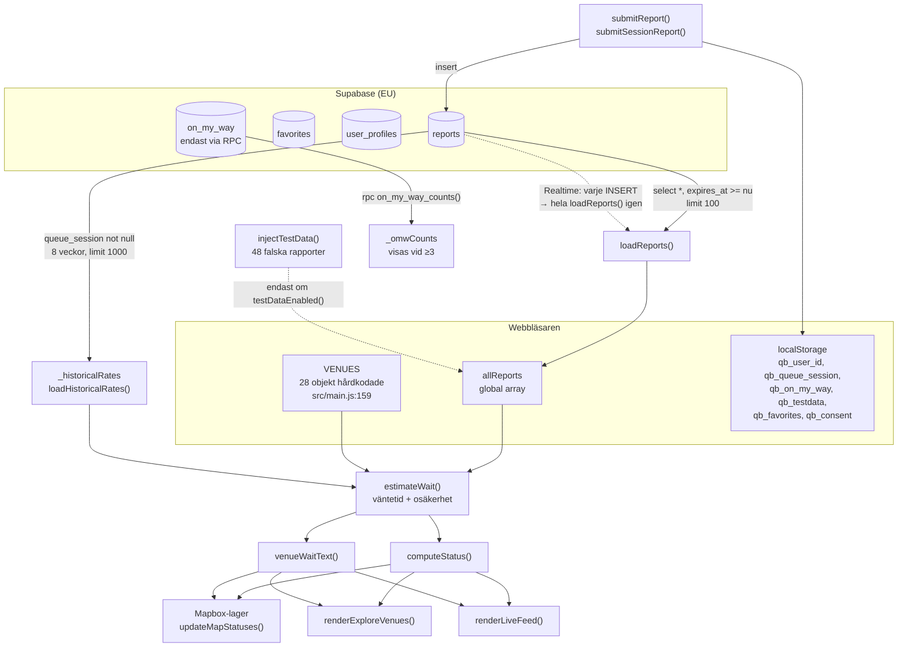

# QueueBar — Arkitektur

Verifierad mot koden 2026-10-18 på grenen `redesign` (HEAD `395f59e`).
Allt i detta dokument är läst ur koden. Avsnitt som inte kunnat verifieras är markerade **OVERIFIERAT**.

---

## 1. Vad systemet är

QueueBar är en **mobil webbapp** som visar köstatus och uppskattad väntetid för 28 barer och
nattklubbar i Stockholms innerstad. Data kommer från användarnas egna rapporter — det finns ingen
extern datakälla för kölängder.

Systemet är i grunden tre saker:

1. En **inmatningsyta** som gör det snabbt att rapportera hur många som står framför dig.
2. En **beräkningsmodell** som omvandlar enstaka opålitliga rapporter till en väntetid med osäkerhet.
3. En **presentationsyta** (karta, lista, flöde) som visar resultatet och hur mycket det går att lita på.

Den svåraste delen är nummer 2. Se [QUEUE_LOGIC.md](QUEUE_LOGIC.md).

---

## 2. Teknisk stack (verifierad)

| Lager | Teknik | Var |
|---|---|---|
| Byggverktyg | Vite 6 | `vite.config.js` |
| Språk | Vanilla JavaScript, ES-moduler, ES5-syntax i kroppen (`var`, `function`) | `src/main.js` |
| Ramverk | **inget** — ingen React, Vue eller Svelte | — |
| Styling | Ren CSS med custom properties | `src/style.css` |
| Karta | `mapbox-gl` 3.x via npm, stil `mapbox://styles/mapbox/dark-v11` | `src/main.js:950` |
| Databas / API | Supabase (PostgREST + Realtime) via `@supabase/supabase-js` 2.x | `src/main.js:66–77` |
| Typsnitt | **Satoshi** (Fontshare CDN) för text, **Geist Mono** (Google Fonts) för siffror | `index.html:14–15` |
| Hosting | Vercel, SPA-rewrite, `Cache-Control: no-store` | `vercel.json` |
| Utvecklingsverktyg | `@frontman-ai/vite` (endast dev) | `vite.config.js` |

Det finns **inget testramverk** och **ingen linter** i projektet. Enda automatiska kontrollen är
`scripts/check.js`. Se [TESTING.md](TESTING.md).

### Andra kodbasen i repot

`QueueBar/` är ett separat **Expo / React Native**-projekt (Expo 57, RN 0.86, `@rnmapbox/maps`).
Det är en **äldre och ofullständig** kopia av appen: 22 ställen i stället för 28, och
väntetidsmodellen finns inte alls där. Det är inte produktionskod och delar ingen kod med webbappen.

---

## 3. Filstruktur

```
index.html                  291 rader   Allt DOM-skelett: 5 skärmar, modaler, bottom sheets
src/main.js                3297 rader   HELA applikationen: data, modell, karta, all rendering
src/style.css              1443 rader   Design tokens + alla komponentklasser
scripts/check.js            123 rader   57 strängbaserade kontroller (pre-commit-grind)
scripts/fetch-osm-venues.mjs 387 rader  Engångsverktyg: hämtar venue-kandidater från OpenStreetMap
data/venues_candidates.*                Resultat från OSM-körningen. Används INTE av appen.
vercel.json                             Deploy-konfiguration
QueueBar/                               Separat, ofullständigt Expo-projekt (ej i produktion)
```

### Startpunkt och körordning

`index.html` laddar `<script type="module" src="/src/main.js">`. Hela `src/main.js` körs som ett
toppnivåskript — det finns ingen `init()`-funktion och ingen `DOMContentLoaded`-väntan. Ordningen är:

1. Importer (`mapbox-gl`, `supabase-js`, `./style.css`)
2. Mapbox-token sätts, `map` skapas (`src/main.js:949`)
3. Supabase-klient skapas (`src/main.js:70`)
4. `VENUES`-arrayen definieras (`src/main.js:159–187`)
5. Alla funktioner deklareras (hissas, så ordningen spelar ingen roll)
6. **`loadReports().then(loadHistoricalPatterns).then(loadHistoricalRates)`** (`src/main.js:1657`)
7. Tre `setInterval`: `loadReports` var 30 s, `loadHistoricalRates` var 30 min
8. `subscribeToReports()` — Realtime-prenumeration
9. `updateProfileStats()`, `filterReportList()`, `checkConsent()`
10. `Object.assign(window, {...})` exponerar 49 funktioner (`src/main.js:3247`)

Steg 10 är **nödvändigt**: HTML-strängarna använder inline `onclick`, och ES-moduler har inget
globalt scope. Lägger du till en ny `onclick`-handler måste den läggas till i det objektet,
annars kastar klicket `ReferenceError`.

---

## 4. Navigation

Det finns ingen router. `showScreen(name)` (`src/main.js:42`) växlar klassen `.active` mellan fem
`<section>`-element i `index.html`:

| Skärm | Element | Ansvar |
|---|---|---|
| Hem | `#screen-home` | Mapbox-karta, bottom sheet med venue-lista, sök |
| Utforska | `#screen-explore` | "Stockholm just nu"-widget + sorterad lista med alla ställen |
| Live | `#screen-live` | Kronologiskt rapportflöde grupperat per ställe |
| Rapportera | `#screen-report` | Tre steg: välj ställe → välj antal framför → bekräftelse |
| Profil | `#screen-profile` | Poäng, nivå, streak, märken, radera data |

URL:en ändras inte vid skärmbyte. Konsekvens: **inget bakåtsteg, inga djuplänkar, ingen
delningsbar vy.** `?testdata=true` är den enda URL-parameter som läses.

---

## 5. Dataflöde



### Den enda sanningskällan för väntetid

Varje skärm som visar en väntetid går genom **`venueWaitText(venueId)`** (`src/main.js:386`),
som anropar `estimateWait()` och formaterar med `formatWait()`. Det finns ingen andra väg.
Det är den viktigaste arkitektoniska egenskapen i appen och den ska bevaras.

`getStatusLabel()` (`src/main.js:406`) returnerar fasta strängar (`'~15 min'`, `'~25 min'`,
`'30+ min'`) och används **endast** som reserv när en rapport saknar `people_ahead` — alltså bara
för rapporter skapade före att `people_ahead` infördes.

---

## 6. Modulernas ansvar inuti `src/main.js`

Filen har inga moduler, men den har tydliga avsnitt. Radnumren gäller HEAD `395f59e`.

| Rader | Ansvar | Rena funktioner? |
|---|---|---|
| 1–60 | Importer, PWA-prompt, `showScreen` | nej (DOM) |
| 61–130 | Mapbox-token, Supabase-klient, feltoast, återanslutning | nej |
| 159–187 | `VENUES` — 28 ställen | data |
| 180–225 | `computeConfidence` — **död kod, anropas aldrig** | ja |
| 226–430 | **Väntetidsmodellen** — `estimateWait`, `sessionRates`, `formatWait`, `computeStatus` | **ja** |
| 431–560 | `escapeHtml`, `timeAgo`, toast, dela, bevaka, favoriter | delvis |
| 560–730 | Venue-kort, hemskärmens lista | nej (DOM) |
| 730–940 | Bottom sheet-dragning, kartsök | nej (DOM) |
| 940–1195 | Mapbox: init, ikoner, lager, kluster, pulsanimation | nej |
| 1196–1345 | Supabase-läsning, skelett, felläge, testdata | nej |
| 1409–1545 | **Rapportering** — `submitReport`, kö-sessioner | nej |
| 1550–1670 | Historik, dörrtakt, kalibrering | delvis |
| 1673–1980 | Favoriter, samtycke, onboarding, radera data | nej |
| 1978–2080 | Fuzzy-sökning — `venueScore`, `venueSearch` | **ja** |
| 2103–2410 | Utforska-skärmen: summeringswidget + rader | nej |
| 2419–2560 | Kvällsplan, "bäst nu", avstånd, stängningstid | delvis |
| 2584–2840 | Utforska-rendering, Live-flöde | nej |
| 2840–2995 | "På väg", kö-sessionsbanner | nej |
| 2999–3135 | Rapportskärm, snabbrapport | nej |
| 3134–3245 | Profil: poäng, nivå, streak, märken | nej |
| 3247–3297 | `Object.assign(window, …)` — 49 funktioner | — |

**Konsekvens för utveckling:** de rena funktionerna i raderna 226–430 och 1978–2080 är den enda
koden som kan enhetstestas utan en webbläsare. De är också de som betyder mest. Se
[TESTING.md](TESTING.md).

---

## 7. Externa beroenden och flaskhalsar

| Beroende | Används för | Vad händer om det fallerar |
|---|---|---|
| Supabase REST | Läsa och skriva rapporter | `showExploreError()` i Utforska. Live-flödet och summeringswidgeten visar däremot "inga rapporter" — se risk R-02 i [granskningen](#) |
| Supabase Realtime | Omedelbar uppdatering | Tyst. Pollningen var 30 s täcker upp |
| Supabase RPC `on_my_way_counts` | "På väg"-räknare | Varning i konsolen, räknaren visas inte |
| Supabase RPC `increment_points` | Inget — **funktionen finns inte** | Tyst fel. Poäng räknas ändå klientsidan |
| Mapbox Styles/Tiles | Kartan | `showMapError()` visar ett felläge. **Verifierat fungerande.** |
| Fontshare (Satoshi) | Hela typografin | Fallback `system-ui`. Hela utseendet byter karaktär |
| Google Fonts (Geist Mono) | Alla siffror | Fallback `monospace` |

### Verkliga flaskhalsar

1. **`limit(100)` i `loadReports`** (`src/main.js:1272`) — hela appens tillstånd bygger på de 100
   senaste icke-utgångna rapporterna. En fredag med 28 ställen kan det räcka till under en
   halvtimme, och en kö-sessions första mätpunkt kan hamna utanför fönstret. Då tappas
   hastighetsmätningen tyst.
2. **Realtime + pollning samtidigt** (`src/main.js:1310` och `1663`) — varje INSERT från vilken
   användare som helst får *alla* anslutna klienter att köra `loadReports()` + `loadHistoricalPatterns()`
   på nytt, utöver pollningen var 30 s. Lasten växer kvadratiskt med antalet samtidiga användare.
3. **2,2 MB JS / 628 kB gzip i produktionsbygget** — nästan allt är `mapbox-gl`. Målgruppen står
   utomhus på mobilnät klockan 23.
4. **Ingen kodavdelning** — `src/main.js` måste läsas i sin helhet för varje ändring, av människa
   som av AI-verktyg.

---

## 8. Hur UI kopplas till logiken

Mönstret är genomgående detsamma och ska följas:

```
tillstånd (allReports, VENUES, localStorage)
   → ren beräkning (estimateWait, computeStatus, venueSearch)
   → HTML-sträng byggd med + -konkatenering
   → element.innerHTML = sträng
   → inline onclick="funktionsnamn(...)" → window-exponerad funktion
```

**Två regler som följer av mönstret:**

1. All text som kommer från databasen måste gå genom `escapeHtml()` innan den hamnar i en
   HTML-sträng. Det gäller idag `comment` och `venue_name` (`src/main.js:2367, 2742, 2743`).
2. `venue_id` placeras oescapat i `onclick`-attribut. Det är säkert **endast** därför att
   `loadReports` filtrerar bort rapporter för okända ställen (`src/main.js:1277`). Tas det filtret
   bort öppnas en XSS-väg. Filtret är en säkerhetsmekanism, inte en städning.

---

## 9. Vad som inte kunnat verifieras

**OVERIFIERAT — databasens faktiska tillstånd.** Repot innehåller ingen SQL, inga migrationer och
ingen schemadefinition. Hela datamodellen, alla RLS-policyer, alla triggrar och alla RPC-funktioner
finns bara i Supabase-projektets webbgränssnitt. De är varken versionshanterade eller granskningsbara
från koden. Allt i [DATA_MODEL.md](DATA_MODEL.md) är härlett ur anropen i `src/main.js`.

Försök att läsa PostgREST-schemat direkt misslyckades: Supabase-domänen är inte tillåten i den
nuvarande utvecklingsmiljöns nätverkspolicy.
